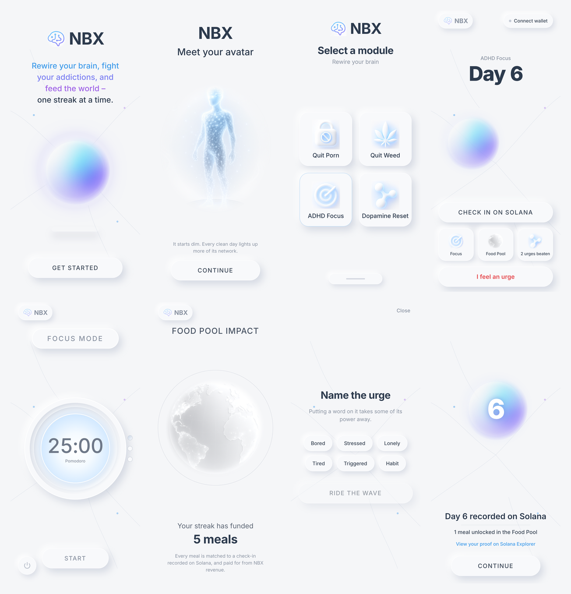

# NBX — NeuroBalanceX

**Science-backed dopamine recovery for the Solana Seeker. Every clean day is recorded on-chain as Proof of Streak, and every recorded day funds a real meal.**



## Why NBX

Streak apps lose most users within a month: points stop mattering once the novelty wears off. NBX adds two kinds of stakes that don't fade:

- **Proof of Streak on Solana.** Each daily check-in is a transaction the user signs with their own wallet. Their recovery becomes a record they own and can verify, not a number in someone's database.
- **The Food Pool.** Each verified day unlocks one meal, paid for from NBX revenue through food partners. Breaking a streak doesn't just reset a counter; it pauses a meal.

Underneath sits the science: Craving Mode uses urge labelling and the ~90-second craving peak (urge surfing), and the program modules are built around dopamine baseline recovery.

## What's built

| Screen | What it does |
|---|---|
| Welcome, Meet your avatar | Onboarding into the NBX world |
| Select a module | Quit Porn, Quit Weed, ADHD Focus, Dopamine Reset |
| Home | Streak, the Neuro Orb (brightens as the streak grows), **Check in on Solana** |
| Proof | Confirms the day landed on-chain, links to Solana Explorer, 7-day badge |
| Craving Mode | Name the urge → ride a 90-second wave → redirect → win |
| Focus Mode | 25 / 50 / 15-minute clay dial timer |
| Food Pool | Meals funded, one per on-chain check-in |

## How Proof of Streak works

1. The app connects to the wallet on the phone through **Mobile Wallet Adapter** (the Seeker's built-in wallet, Phantom, Solflare…).
2. On check-in it builds one transaction containing an **SPL Memo**:
   `NBX proof-of-streak v1 | day 6 | adhd-focus | 2026-10-22`
3. The user signs and sends it from their own wallet. The signature is the receipt, viewable on Solana Explorer.

No personal or health data goes on-chain: only the day number, module and date. The code lives in [`src/solana/wallet.ts`](src/solana/wallet.ts). It runs on **devnet** today; mainnet comes with the dApp Store release.

## Run it on a Seeker

This app uses native modules (Mobile Wallet Adapter), so it runs as an installed APK, not in Expo Go.

**Option A: cloud build (no Android Studio needed)**

```bash
npm install
npx eas-cli@latest login            # free Expo account
npx eas-cli@latest build -p android --profile preview
```

When the build finishes, open the link it prints on the Seeker and install the APK.

**Option B: build over USB** (Android Studio installed, phone in developer mode, USB debugging on)

```bash
npm install
npx expo run:android --device
```

**Before your first check-in:** switch the wallet on the phone to **devnet**, then tap *Get 1 devnet SOL* in the app if it asks for fees (or use [faucet.solana.com](https://faucet.solana.com)).

## Stack

Expo SDK 58 · React Native 0.88 · Expo Router · `@solana/web3.js` · `@solana-mobile/mobile-wallet-adapter-protocol-web3js` · Inter

## Roadmap

1. Publish to the **Solana dApp Store** (Seeker).
2. Milestone badges (day 7 / 30 / 90) as compressed NFTs.
3. Squad accountability: small groups who see each other's on-chain streaks.
4. Food Pool partner reporting, with each meal batch linked to the check-ins that unlocked it.
5. Mainnet launch.

NBX is a wellness and habit-support tool, not a medical treatment.

Built by Nomads Lab · [nomadslab.agency](https://nomadslab.agency)
